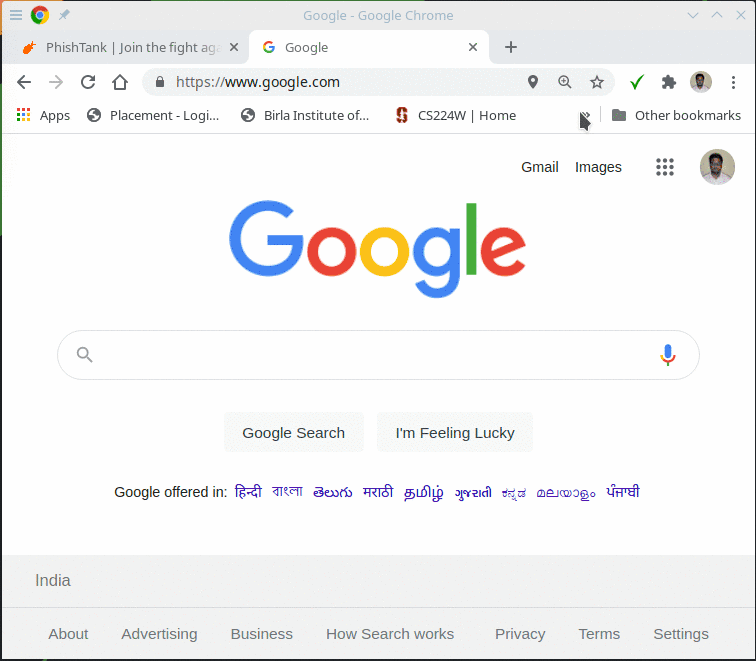
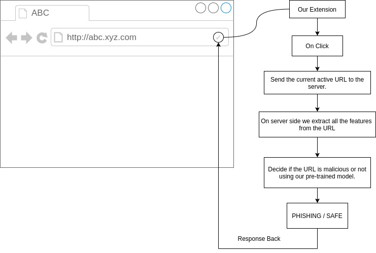
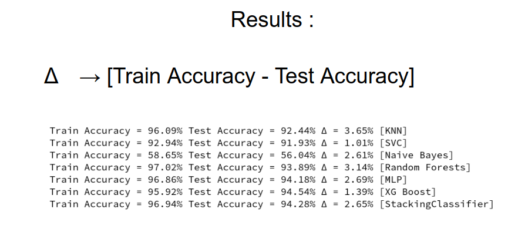

# URL Shield - A browser extension that detects and blocks malicious websites



# Introduction

**URL Shield** protects everyday browsing automatically. As you navigate, it
checks each site against a layered set of safety checks and blocks the
dangerous ones before they can do harm. It combines Google Safe Browsing, SSL
certificate verification, a local blacklist, and a pretrained machine-learning
model, and it also guards sensitive browser permissions and stops risky file
downloads on sites that aren't verified safe.

- [Introduction](#introduction)
- [How it Works ?](#how-it-works-)
  - [What Problem it Solves ?](#what-problem-it-solves-)
- [Tech Stack](#tech-stack)
- [Usage](#usage)
  - [Directory Structure](#directory-structure)
  - [Backend](#backend)
  - [Extension](#extension)
- [Acknowledgments](#acknowledgments)

# How it Works ?



A background service worker in the extension sends every URL you visit to a
local Python backend. The backend runs the checks below in order and returns a
single verdict; if the verdict is dangerous, the extension redirects the tab to
a block page. On sites that aren't verified safe, the extension also blocks
camera / microphone / location requests and cancels risky downloads.

The pretrained ML model extracts the following features from a url :


  
| Feattures     Used                  |                                   |                            |                     |
| ----------------------------------- | --------------------------------- | -------------------------- | ------------------- |
| Having IP address                   | URL Length                        | URL Shortening service     | Having @ symbol     |
| Having double slash                 | Having dash symbol(Prefix Suffix) | Having multiple subdomains | SSL Final State     |  | Domain Registration Length | Favicon | HTTP or HTTPS token in domain name | Request URL |
| URL of Anchor                       | Links in tags                     | SFH - Server from Handler. | Submitting to email |
| Abnormal URL                        | IFrame                            | Age of Domain              | DNS Record          |
| Web Traffic -  using data.alexa.com | Google Index                      |                            | Statistical Reports |
 
 
 
  We have iterated multiple times during training phase :
  
  <!-- 1. Random Forest Model ( 93.14% Accuracy )
  1. MLP Model ( 94.17% Accuracy ) -->
  

<br/>

## What Problem it Solves ?

 Every other website in today's day and age on the internet wants to collect data of its users by tricking them into giving away their credentials for fraud or many such vindictive acts. Naive users using a browser have no idea about the backend of the page. The users might be tricked into giving away their credentials or downloading malicious data.

We have created an extension for Chrome that will act as middleware between the users and the malicious websites and relieve users of giving away to such websites.
Our project was made by keeping in the mind the regular internet user who has to go through many websites during his time on the internet and may fall under a trap of a malicious website who might want the user's information or want to introduce malware in their system. Our chrome extension helps the user to check a particular website whether it is safe for browsing or not

# Tech Stack

- [HTML](https://www.w3schools.com/html/) - The front-end development language used for creating extension.

- [CSS](https://www.w3schools.com/css/) - The  front-end development language used for creating extension.

- [Python](https://www.python.org/) - The Programing Language used to parse features from a website and for training/testing of the ML model.
- [JavaScript](https://www.javascript.com/) - The scripting language used for the extension (popup + background service worker).

- [Beautiful Soup](https://pypi.org/project/beautifulsoup4/) - The library used to scrape websites from a url.
- [Googlesearch](https://pypi.org/project/googlesearch-python/) - The library for  performing google search's during feature extraction.

- [whois](https://pypi.org/project/whois/) - The package for retrieving WHOIS information of domains during feature extraction.
- [scikit-learn](https://scikit-learn.org/stable/) -
  The library used for training ML models.
<br/>

# Usage

## Directory Structure

```
.
|-- LICENSE
|-- README.md
|-- .env.example            # copy to .env and add your API key
|-- requirements.txt
|-- extension               # the Chrome/Edge extension (Manifest V3)
|   |-- icon.png
|   |-- manifest.json
|   |-- background.js       # auto-checks pages, blocks downloads, trust map
|   |-- content.js          # guards camera/mic/location on untrusted sites
|   |-- popup.html
|   |-- popup.js
|   |-- style.css
|   |-- blocked.html        # shown when a site is blocked
|   |-- blocked.js
|   `-- blocked.css
|-- models
|   |-- mlp_model.pkl       # the pretrained model used at runtime
|   `-- random_forest.pkl
|-- test                    # the backend server + ML feature extraction
|   |-- server.py           # HTTP backend on localhost:8000
|   |-- security_checks.py  # blacklist, Safe Browsing, SSL checks
|   |-- test.py             # runs the ML model
|   |-- features_extraction.py
|   `-- patterns.py
`-- train                   # scripts to retrain the models
    |-- data
    |   `-- web_data.arff
    |-- train_mlp.py
    `-- train_rf.py
```

## Backend

The backend is a small Python server (`test/server.py`) that classifies every
URL. It needs no PHP and runs on Windows, macOS and Linux.

1. Clone the repo and install the dependencies:

   ```
   pip install -r requirements.txt
   ```

2. Create your environment file from the template and add a Google Safe
   Browsing API key (free from the Google Cloud Console):

   ```
   cp .env.example .env      # on Windows: copy .env.example .env
   ```

   Then edit `.env` and set `GOOGLE_SAFE_BROWSING_API_KEY`. Leave it blank to
   skip the Safe Browsing check.

3. Start the server:

   ```
   cd test
   python server.py
   ```

   It listens on `http://localhost:8000`.

### What it checks

Each URL is run through these checks in order (first failure wins):

| Verdict       | Meaning                                                       |
| ------------- | ------------------------------------------------------------- |
| `BLACKLISTED` | Host is on the local blacklist of known-bad sites             |
| `MALICIOUS`   | Google Safe Browsing flagged it (malware / phishing / PUA)    |
| `SSL_FAILED`  | HTTPS certificate is missing, invalid or expired              |
| `PHISHING`    | The pretrained MLP model classified it as phishing            |
| `SAFE`        | Passed every check                                            |

Malicious, phishing and Safe-Browsing hits are added to `test/blacklist.txt`
automatically, and every check is logged to `test/url_shield.log`.

## Extension

1. Open `chrome://extensions`.
2. Enable **Developer mode** (top right).
3. Click **Load unpacked** and select the `extension` folder.

The extension protects you **automatically** — a background service worker
checks every page you navigate to and redirects you to a block page if the
site is dangerous. No clicking required. Clicking the toolbar icon runs a
full check (including the ML model) on the current page on demand.

### Extra protections

Beyond blocking dangerous pages, the extension also:

- **Guards sensitive permissions.** On any site that is not verified `SAFE`,
  requests for the camera, microphone, location, or notifications are blocked
  before the browser prompt ever appears. Sites verified safe work normally.
- **Stops risky downloads.** Downloads of executable / script file types
  (`.exe`, `.bat`, `.scr`, `.msi`, `.js`, `.jar`, `.apk`, and similar) from
  untrusted sites are cancelled automatically, and you get a notification.
  Downloads from trusted sites are left alone.

Both protections treat a site as trusted only when the backend classified it
`SAFE`; unknown or flagged sites are treated as untrusted (fail-closed).
</br>

# Acknowledgments

A very heartful thanks to the authors and owners of the following articles which propelled us to make URL Shield.

- [Malicious URL Detection based on Machine Learning](https://thesai.org/Downloads/Volume11No1/Paper_19-Malicious_URL_Detection_based_on_Machine_Learning.pdf)
- [Detecting malicious URLs using machine learning techniques](https://ieeexplore.ieee.org/document/7850079)
- [Malicious URL Detection using Machine Learning: A Survey](https://arxiv.org/pdf/1701.07179.pdf)
  
And also lots of gratitude for the whole team of "HackNITR 2021" for providing us the perfect platform to showcase our idea.
